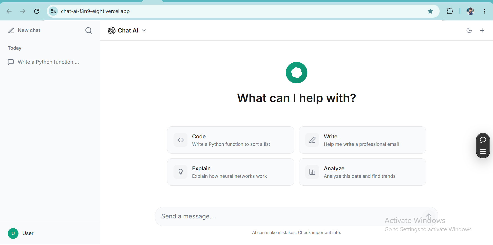
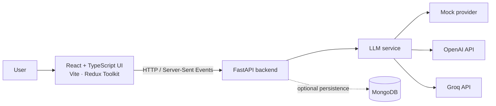

# Chat AI

A ChatGPT-style chat application with a React and TypeScript frontend and a FastAPI backend. It supports streamed responses from OpenAI and Groq, plus a built-in mock provider for local development without an API key.

## Screenshot



## Features

- Stream assistant responses as they are generated.
- Start new conversations; revisit and delete saved conversations when MongoDB is configured.
- Switch between light and dark themes.
- Choose a response provider: mock, OpenAI, or Groq.
- Optionally persist conversations in MongoDB.
- Check backend status and configuration at `/health`.

## Architecture



The frontend sends chat requests to the backend. The streaming endpoint returns Server-Sent Events (SSE). When MongoDB is configured, the backend stores conversations and messages there; without it, database-backed history is unavailable.

## Tech stack

| Area | Technologies |
| --- | --- |
| Frontend | React 19, TypeScript, Vite, Redux Toolkit, Tailwind CSS, Radix UI |
| Backend | Python 3.11+, FastAPI, Pydantic, Uvicorn |
| AI providers | Mock, OpenAI, Groq |
| Optional storage | MongoDB via Motor |

## Local setup

You will need Node.js and npm for the frontend, and Python 3.11 or newer for the backend.

### 1. Get the project

```bash
git clone https://github.com/pritamkumarbishwas/chat-ai.git
cd chat-ai
```

### 2. Start the backend

In a terminal:

```powershell
cd backend
python -m venv .venv
.\.venv\Scripts\Activate.ps1
python -m pip install -r requirements.txt
```

Create `backend/.env` with the provider settings you want. Mock mode works without any API key:

```env
LLM_PROVIDER=mock
```

To use Groq or OpenAI instead, select the provider and set its key:

```env
LLM_PROVIDER=groq
GROQ_API_KEY=your-groq-api-key
# Optional; defaults to openai/gpt-oss-20b
GROQ_MODEL=openai/gpt-oss-20b
```

Or for OpenAI:

```env
LLM_PROVIDER=openai
OPENAI_API_KEY=your-openai-api-key
# Optional; defaults to gpt-4o
OPENAI_MODEL=gpt-4o
```

MongoDB persistence is optional. Add a connection URI and, if needed, a database name to the same `backend/.env`:

```env
MONGO_URI=your-mongodb-connection-uri
MONGO_DB_NAME=learn-ai
```

Run the API from the `backend` directory:

```powershell
uvicorn app.main:app --reload --port 8000
```

The API is available at `http://localhost:8000`; interactive docs are at `http://localhost:8000/docs`.

### 3. Start the frontend

In a second terminal, from the project root:

```powershell
cd frontend
npm install
npm run dev
```

Open the local URL printed by Vite (typically `http://localhost:5173`). By default, the frontend connects to `http://localhost:8000`. To use another backend URL, create `frontend/.env.local`:

```env
VITE_API_URL=https://your-backend.example.com
```

## API

| Method | Endpoint | Description |
| --- | --- | --- |
| `POST` | `/api/chat` | Get a complete assistant response |
| `POST` | `/api/chat/stream` | Stream an assistant response over SSE |
| `GET` | `/api/conversations` | List saved conversations |
| `GET` | `/api/conversations/{conversation_id}` | Get messages for a conversation |
| `DELETE` | `/api/conversations/{conversation_id}` | Delete a saved conversation |
| `GET` | `/health` | Backend health and provider configuration |

## Development checks

Run these from `frontend`:

```bash
npm run build
npm run lint
```

## Project layout

```text
backend/
  app/
    api/routes/       Chat and conversation endpoints
    core/             Settings and MongoDB connection
    schemas/          Request and response models
    services/         LLM providers and conversation history
  requirements.txt
frontend/
  src/
    components/       Chat, layout, sidebar, and UI components
    store/            Redux state and API client
    App.tsx            Application flow
image/
  image.png            Application screenshot
```

## Security note

Keep API keys and database credentials in local environment files or your deployment platform's secret manager. Do not commit `.env` files.
